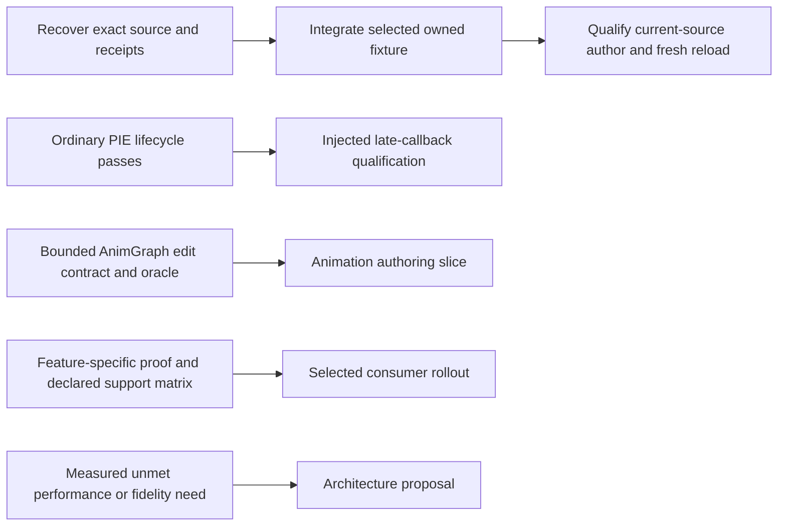

# Roadmap work units

Planning snapshot: 2026-11-07, main through PR #64. The
[backlog](../docs/tracking/backlog.md) owns item status and evidence; this map
groups that work by outcome. [Starting slices](todo.md) are planning choices,
not an execution queue or a claim that implementation has begun.

## How to use this map

A unit is a coherent investment area, not one large PR. Pick a starting slice,
finish its user-visible behavior and regression proof together, then decide
whether the next slice in that unit is still the best use of time. Bundle work
when it shares a handler, fixture or user workflow; sharing a broad topic alone
is not enough. Existing completed work stays completed.

There are three different commitments here:

- Reliability and qualification debt on shipped behavior should be resolved or
  explicitly bounded in support claims.
- Product expansions need a concrete workflow and a bounded acceptance contract.
- Conditional architecture and archived experiments are options, not mandatory
  prerequisites for declaring a release ready. Recovering every snapshot is not
  a product completion criterion.

## Units and their starting points

| Unit | Outcome and backlog coverage | First independently useful slice | Completion evidence for that slice |
|---|---|---|---|
| U1 — Trustworthy command contracts | Users can trust validation and result fields. BUG-3; EN-8 P1; EN-5. | Correct timer compile/ghost-link failure reporting. Separately reproduce unknown-parameter handling, then add schema checks where they prevent that defect class. | A failing compile/link cannot report success; negative tests exercise actual failures. Unknown parameters fail before action when that slice is taken. |
| U2 — Reliable editor sessions | Attach, play, stop and continue predictably. QA-1; F-14; OWN-1a/1b. | Current-source owned-host smoke with identity, representative read/write and stop-followed-by-operation. Recover ordinary PIE machinery only if useful to this check. | Actual teardown precedes the next operation; two ordinary cycles pass. Late-callback injection has a separate timeout/fence/drain gate. |
| U3 — Useful and contained visual inspection | Screenshots, previews and Details reads are usable. EN-28; OWN-4; visual portion of QA-3. | Reproduce screenshot/preview path confinement and inspect an actual output image. Details paging is a separate slice. | Out-of-root writes rejected, valid output inspected; paging later requires actual native/editor/rendered proof, not mocked controls alone. |
| U4 — Animation diagnosis | Agents can explain an AnimBP and selection logic. Animation/Chooser residual. | Qualify shipped `get_anim_graph` properties, topology and defaults on an owned AnimBP; identify specific missing fields. | Returned state/transition/slot/blend/pin data matches an independent fixture oracle. Chooser row/result mapping gets a separate contract and oracle. |
| U5 — Bounded animation authoring | Insert an existing named Slot into an exact top-level local-space pose edge. New scope; see the [U5 contract](../docs/plans/u5-animation-authoring.md). | Owned fixture and revision/preflight checks, then transactional insertion and MCP lifecycle qualification. Check upstream equivalents first. | Exact edge delta, no Skeleton mutation, truthful compile failures, one-step Undo/Redo and explicit save/restart; details and negative cases are in the scoped contract. |
| U6 — Material authoring expansion | Complete a material workflow beyond scalar functions. EN-32. | Select one typed vector workflow and its required nodes; texture inputs, function instances, layers/blends and interface migration are later independent slices. | Independent topology/value oracle, successful compile, Undo/Redo and save/restart for that exact workflow; retain documented allocation/propagation/timeout boundaries. |
| U7 — Asset and gameplay understanding | Find assets, explain references and inspect gameplay data. EN-1; EN-8 P2/P3/P4/P6/P7. | Reproduce bounded registry queries and choose one useful search/filter improvement. Reverse-reference search and GameplayEffect reads are separate follow-ups. | Known corpus yields correct bounded results and explicit truncation/fidelity; reference and gameplay slices each need their own positive/negative oracle. |
| U8 — Data-asset and GAS authoring | Safely change gameplay content through purpose-built operations. EN-30. | Choose one asset type and one supported mutation rather than a generic GAS authoring system. | Correct readback, validation, dirty/save behavior, Undo/Redo and restart persistence. U7 read support is needed only if it supplies the chosen mutation's oracle. |
| U9 — Offline fidelity and portable fixtures | Developers can reproduce parser failures without consumer projects. FText histories; EN-8 P5/EN-4; T-1b/c; OWN-2; OWN-3a/3b; FX-1; DR-1; parser portions of legacy proposals. | Audit OWN-3a source/receipt provenance and recover the smallest useful data-flow fixture. Pair each later decoder change with a representative owned or synthetic fixture. | Source/asset/oracle hashes bind to available evidence; current-source author and separate-process reload pass; parser consumer agrees. World, Blueprint persistence and TMap proof remain separate. |
| U10 — Supported delivery and onboarding | Users receive a known revision that works in their supported environment. QA-2; remaining QA-3; OPS-1; EN-3. | State the release's supported engine/client/renderer combinations and run one real desktop-client/editor acceptance workflow on an owned host. | Evidence identifies source revision and exact environment. Selected consumer deployment later has before/after verification and editor/client restart; target selection is still required. |
| U11 — Measured performance and architecture | Optimize an observed bottleneck without speculative rewrites. EN-23; EN-22; DR-2; broad-refactor/full-3F legacy proposals. | When a performance or fidelity decision arises, collect the smallest missing measurement and compare existing routes. | A repeatable workload establishes the problem and improvement. Event push, full graph-byte parsing or broad refactors proceed only with a demonstrated need and a bounded design. |
| U12 — Organization and research upkeep | Keep repo structure, evidence and technical decisions current. AUD-1/AUD-2/AUD-3; see [audit cadence and ecosystem watch](../docs/tracking/ecosystem-watch.md). | Review task cleanup and relevant source assumptions within each slice; perform a bounded monthly ecosystem/organization checkpoint while active. | Findings resolved, explicitly retained or tied to one owned backlog item; source dates/revisions and adopt/experiment/defer/reject decisions recorded. No automatic upgrades or scheduled automation implied. |

## What belongs together, and what should stay separate

- **U1:** BUG-3's failure reproduction, result correction and regression belong in
  one change. YAML/handler lint is a reusable follow-up, not a reason to delay
  the specific fix. EN-8 P1 owns rejection; U7 owns valid-query bounds/aliases.
- **U2:** ordinary PIE coverage and F-14 share the lifecycle oracle. Injected
  late callbacks are a separate failure mode and should not inflate the first PR.
- **U3/U10:** one captured output can support both visual inspection and client
  acceptance only if both were actually observed. File creation is not rendered
  acceptance. Details paging also needs its own Python-enabled host setup.
- **U4/U5:** reuse the owned AnimBP and graph oracle. Read-only diagnosis can ship
  without authoring, and authoring need not wait for unrelated Chooser support.
- **U6/U8:** reuse lifecycle-runner patterns, not one combined material/GAS PR.
  Asset-specific semantics and verification remain separate.
- **U9:** recover fixtures just in time for the product/parser behavior they
  qualify. The 39 archived states are overlapping evidence, not 39 deliverables.
  FExpressionInput/FieldPath and the int64 VFX report require their own repro;
  existing sidecar support must be accounted for before expanding full 3F scope.

## Real dependencies

These arrows apply to the named slices, not to every unit. U1, U3, U4, U6, U7
and U8 do not need all recovery work to finish first. U5 can reuse U4's oracle
or establish its own bounded oracle; the entire animation diagnosis unit is not
a prerequisite. Broad platform claims require U10 qualification, while a clearly
bounded single-environment feature can be qualified in that environment first.

U12 supplies small checks across all paths; it is not an audit phase that blocks
unrelated implementation. Check existing engine and peer capabilities before
committing to a new implementation, and keep documentation/cleanup within each slice.

## Useful paths through the units

| Path | Useful combination | What it unlocks |
|---|---|---|
| Everyday dependable use | U1 timer correctness + U2 lifecycle smoke + U3 confinement/output | Trustworthy existing commands and fewer interrupted sessions. |
| Animation user support | U4 existing-read qualification, then choose missing read/Chooser support or U5 authoring | Immediate diagnostic usefulness, with a deliberate choice about editing scope. |
| Content creation | One U6 material workflow **or** one U8 gameplay asset mutation, then relevant U10 delivery checks | A complete usable authoring feature instead of a broad half-finished API surface. |
| Developer confidence | Selected U9 fixture + its parser consumer; U1 schema checks when useful | Portable failure reproduction and less reliance on external projects. |
| Release readiness | U10 supported-environment checks + relevant U1/U2/U3 findings | An honest support statement and a reproducible deployment. |

My suggested initial portfolio is **the BUG-3 fix**, **one animation readback
qualification slice**, and **the engine-free OWN-3a provenance audit**. They
address correctness, visible user value and recoverable developer investment.
Choose which native slice gets the machine first; this is not a mandate to run
three concurrent editors. A confirmed unsafe write or silently widened mutation
supersedes this suggestion. If a consumer rollout is imminent, move the relevant
U10 acceptance ahead of feature expansion.

## Resource and change coordination

Engine-free work includes receipt/source reconciliation, contract design,
documentation, synthetic parser tests and schema analysis. Native compilation,
live-editor tests, UI observation and save/restart checks require an owned-host
slot. On this machine, serialize those heavy phases and port-using Node suites;
independent roadmap units do not imply safe simultaneous resource use.

Use the existing checkout when isolation is unnecessary. When separate sessions
are actually scheduled, coordinate shared `tools.yaml`, handlers, fixture runners
and generated registration changes. Use separate owned asset directories; port
isolation does not make concurrent writes to the same assets safe. Record owned
processes and outputs, clean them after retaining concise receipts, and use the
repository's single worktree convention if a worktree is genuinely necessary.

## Verification and completion policy

For each selected implementation slice, first turn its starting task into a
bounded handoff naming exact files, commands, fixture and expected failures.
Keep it small enough for a focused review; split it if multiple independent
subsystems or acceptance contracts are involved.

Run `npm test` for server/tool-surface changes, applicable native tests and plugin
compilation for C++ changes, and owned live checks for claims about editor
behavior. Persistence needs a fresh-process read; Undo needs actual restoration;
failure reporting needs a real failure. Do not substitute one proof category for
another. After each slice, review the diff, reconcile backlog status and record
unverified environments before choosing the next slice.

No implementation, live requalification or consumer deployment is implied by
this planning document. Conditional expansion scope is deliberately not frozen;
completing a release means closing its selected contracts and qualifying its
support claims, not exhausting every possible enhancement in the backlog.
