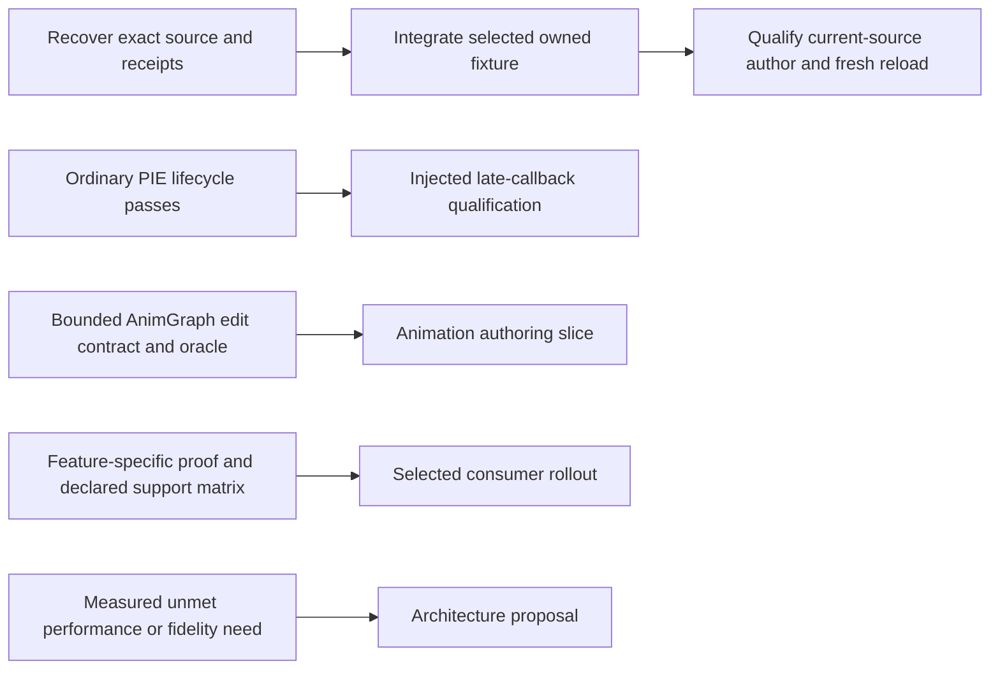

# Roadmap work units

Planning snapshot: 2026-11-07, main through PR #64. The
[backlog](../docs/tracking/backlog.md) owns item status and evidence; this map
groups that work by outcome. [Starting slices](todo.md) are planning choices,
not an execution queue or a claim that implementation has begun.

## Core correctness before the next character experiment (2026-11-22)

Pause new animation experiments while two owners qualify the transport decoder
and shared Blueprint writers. The coordinator owns the integrated build,
independent review and final agent replay. Use the [execution checklist](todo.md#core-correctness-execution-checklist-2026-11-22)
to record revisions, results and open findings. The earlier U1/U2/U5 selection
below remains the history of the preceding animation milestone.

**Transport.** Start a task worktree from local main at `0d7ec96`. The
[decoder issue](../docs/tracking/backlog.md#current-work-and-next-qualification)
has a retained UE 5.3.2 Win64 package. The earlier nine-test run failed one
test with two assertions. Framed and legacy JSON both failed the expected
one-code-unit readback for escaped U+0000. The same suite passed on 5.6.1 and
5.8.4. Reuse the native regression and a working copy of the owned fixture.
Compare the engine JSON reader's value with UEMCP's decoded value before
choosing a repair. Use the original fixture and package fingerprints as evidence
through closeout.

**Blueprint writers.** Start with a read-only comparison of local main and
`task/graph-action-placement` at `f0901ce`, which contains the reviewed setter
work from `task/animation-authoring` at `e6e9c35`. Inventory writer, schema,
dispatcher and regression dependencies before choosing commits for a focused
core review. Preserve existing animation worktrees and prior evidence. Trace
`add_variable_assignment` separately from `add_variable_set`. The recorded
assignment rounding, vector formatting, ambiguous graph selection and function
entry concerns each need a control. Use native object and graph observations,
freshly compiled actor behavior, and affected package hashes to judge the public
MCP result. Record a passing control as a bounded result. Give each reproduced
failure its own repair and rerun.

**Workstation coordination.** Use task branches under `.worktrees/` and one
coordinator-allocated run directory with per-engine and per-task children.
Follow the [fixture guide](../docs/fixture-host.md#stage-a-fresh-host) for external
staging if creating a fresh owned host. Check the installed engine manifest,
editor and build tool before booking each engine. Serialize builds, deployments
and editor runs. Give the first slot to the 5.3.2 decoder reproduction while
the writer owner reviews source and prepares cases. Then give the writer owner
5.8.4 for public MCP reproduction while the decoder owner works from the
captured values.

### Cleanup ownership before the first run

The coordinator chooses one run root before either owner stages a fixture.
Use `new-task-root.ps1 -Task core-correctness` for a repo-local run, or add
`-ExternalFixture` if this run requires a fresh external stage. Pass that same
path to both owners. On resumption, use the recorded path. Create each child
only when its caller needs it.

At allocation, copy the applicable rows below into the root's `RUN.md`.
Record the exact paths, owners, expected peak bytes, available disk space and
receipt destination before the first large copy. Include simultaneous source,
staged and packaged copies in the estimate. If they will not fit, serialize
the copies or narrow the staged inputs. Record owned process IDs as they start.

| Output and owner | Evidence to keep | Earliest removal point |
| --- | --- | --- |
| Decoder working fixture and diagnostic build — decoder owner | Baseline and repaired code units for each transport, test output and build fingerprints | After the last comparison that needs that copy, once its receipt is readable and the process has exited. The original `.scratch/retained/ue53-decoder` has its own one-time release at issue closeout. |
| Blueprint fixtures and temporary assets — writer owner | Requested and observed values, graph identities, Undo and dirty-state results, reopened asset and actor observations | After the last dependent replay. Inventory test-created packages before editing a reused owned host so cleanup touches only those packages. |
| Package stages, build intermediates, caches and any private toolchain copy — owner running that engine | Native test list and results, packaging log, manifest and DLL/corpus hashes | After that engine's final consumer has run. Before a retry, extract the failure evidence, release superseded output and recalculate the next attempt's peak. |
| Agent trial profiles, transcripts and test processes — replay owner | Sanitized prompt, client and engine versions, relevant calls and independent result | Once the replay receipt is verified and the owned processes have exited. Keep account configuration and credentials out of the receipt. |
| New core worktrees and branches — coordinator | Reviewed commits and any unique untracked or ignored evidence | After merge and recovery checks, remove clean task worktrees with Git, then retire their merged branches. The two pre-existing animation worktrees belong to the continuing animation task. |

At each engine handoff, the outgoing owner records what was removed and the
exact path, size, next consumer and release condition of anything still needed.
After an interruption, reconcile that inventory and live processes before
allocating a retry. For an unresolved defect, retain the smallest verified
reproducer with an owner and a backlog release condition. For final closeout,
copy the concise receipts and disposition into the primary checkout's local
report, verify they can be read there, and remove the empty run root. Use the
[repository cleanup checks](../AGENTS.md#worktree-and-scratch-cleanup) for
process ownership, resolved paths and shared links at every removal.

### When removal is denied

Pair `new-task-root.ps1` with an on-demand PowerShell cleanup command for
future runs. Have the allocator record a machine-readable run identity. Give
the cleanup command a run and its explicitly retired outputs. Its default
preview lists the resolved paths, ownership, sizes and reasons for skipping
anything. On explicit apply, revalidate the preview, remove only unchanged,
inactive outputs within that run and record what remains. Leave retained issue
fixtures and Git worktrees to their own closeout procedures. Use the existing
decoder helper's inventory checks where applicable. A code review of the
helper and action review of a particular invocation are separate decisions.

Plan each large stage using measured free space with the prior output still
present. Exclude unnecessary third-party content before copying and reuse the
installed toolchain where possible. A successful scratch smoke test establishes
its own outcome only. Approval for a later deletion depends on that action.

If automatic approval review rejects cleanup, the owner records the attempted
action and review reason in `RUN.md`, then inventories the exact surviving paths
and bytes. Apply the [repository denial procedure](../AGENTS.md#worktree-and-scratch-cleanup).
The coordinator reports the path, size, why it is disposable or still needed,
and what the denial holds up. Where manual disposition is appropriate, give the
user the verified path and leave the choice with them. After any manual removal,
recheck path existence and volume free space before changing the ledger.

Proceed with another engine stage only if it fits alongside the leftovers.
Otherwise pause that allocation and continue source review, receipt analysis or
other work that fits. Carry outstanding cleanup in the closeout until actual
removal is verified or the owner explicitly accepts retention.

**Integration and release.** The previous nine-test package included two graph
regressions from the placement branch. Run the seven transport tests on the
core candidate, then run the original nine named tests on a candidate containing
the placement tests and both core repairs. Record both revisions and test lists.
Review confirmed fixes independently and run the final real-client trial on the
integrated revision. Resume the same-character experiment after the checklist
passes. Keep the UE 5.7 installation deferred and human sessions after the
agent-driven animation milestone. Capture, registry and PIE lifecycle reports
retain their own backlog entries.

## How to use this map

A unit is a coherent investment area, not one large PR. Pick a starting slice,
finish its user-visible behavior and regression proof together, then decide
whether the next slice in that unit is still the best use of time. Bundle work
when it shares a handler, fixture or user workflow; sharing a broad topic alone
is not enough. Existing completed work stays completed.

There are three different commitments here:

- Reliability and qualification debt on shipped behavior should be resolved or
  explicitly bounded in support claims.
- Product expansions need a concrete workflow and a bounded acceptance contract.
- Conditional architecture and archived experiments are options, not mandatory
  prerequisites for declaring a release ready. Recovering every snapshot is not
  a product completion criterion.

## Units and their starting points

| Unit | Outcome and backlog coverage | First independently useful slice | Completion evidence for that slice |
|---|---|---|---|
| U1 — Trustworthy command contracts | Users can trust validation and result fields. BUG-3; EN-8 P1; EN-5. | Correct timer compile/ghost-link failure reporting. Separately reproduce unknown-parameter handling, then add schema checks where they prevent that defect class. | A failing compile/link cannot report success; negative tests exercise actual failures. Unknown parameters fail before action when that slice is taken. |
| U2 — Reliable editor sessions | Attach, play, stop and continue predictably. QA-1; F-14; OWN-1a/1b. | Current-source owned-host smoke with identity, representative read/write and stop-followed-by-operation. Recover ordinary PIE machinery only if useful to this check. | Actual teardown precedes the next operation; two ordinary cycles pass. Late-callback injection has a separate timeout/fence/drain gate. |
| U3 — Useful and contained visual inspection | Screenshots, previews and Details reads are usable. EN-28; OWN-4; visual portion of QA-3. | Reproduce screenshot/preview path confinement and inspect an actual output image. Details paging is a separate slice. | Out-of-root writes rejected, valid output inspected; paging later requires actual native/editor/rendered proof, not mocked controls alone. |
| U4 — Animation diagnosis | Agents can explain an AnimBP and selection logic. Animation/Chooser residual. | Qualify shipped `get_anim_graph` properties, topology and defaults on an owned AnimBP; identify specific missing fields. | Returned state/transition/slot/blend/pin data matches an independent fixture oracle. Chooser row/result mapping gets a separate contract and oracle. |
| U5 — Animation authoring program | Leading feature priority: Animation Blueprints, sequences, montages, timeline data and supporting rig/assets. See the [program scope](../docs/plans/animation-authoring-program.md). | The task branch covers the Event Graph–driven blend and Slot insertion. Use the program inventory to select the next workflow. | Workflow-specific validation, mutation results, Undo/save/restart and evaluated-motion checks where required; no claim of completeness from a single tool. |
| U6 — Material authoring expansion | Complete a material workflow beyond scalar functions. EN-32. | Select one typed vector workflow and its required nodes; texture inputs, function instances, layers/blends and interface migration are later independent slices. | Independent topology/value oracle, successful compile, Undo/Redo and save/restart for that exact workflow; retain documented allocation/propagation/timeout boundaries. |
| U7 — Asset and gameplay understanding | Find assets, explain references and inspect gameplay data. EN-1; EN-8 P2/P3/P4/P6/P7. | Reproduce bounded registry queries and choose one useful search/filter improvement. Reverse-reference search and GameplayEffect reads are separate follow-ups. | Known corpus yields correct bounded results and explicit truncation/fidelity; reference and gameplay slices each need their own positive/negative oracle. |
| U8 — Data-asset and GAS authoring | Safely change gameplay content through purpose-built operations. EN-30. | Choose one asset type and one supported mutation rather than a generic GAS authoring system. | Correct readback, validation, dirty/save behavior, Undo/Redo and restart persistence. U7 read support is needed only if it supplies the chosen mutation's oracle. |
| U9 — Offline fidelity and portable fixtures | Developers can reproduce parser failures without consumer projects. FText histories; EN-8 P5/EN-4; T-1b/c; OWN-2; OWN-3a/3b; FX-1; DR-1; parser portions of legacy proposals. | Audit OWN-3a source/receipt provenance and recover the smallest useful data-flow fixture. Pair each later decoder change with a representative owned or synthetic fixture. | Source/asset/oracle hashes bind to available evidence; current-source author and separate-process reload pass; parser consumer agrees. World, Blueprint persistence and TMap proof remain separate. |
| U10 — Supported delivery and onboarding | Users receive a known revision that works in their supported environment. QA-2; remaining QA-3; OPS-1; EN-3. | State the release's supported engine/client/renderer combinations and run one real desktop-client/editor acceptance workflow on an owned host. | Evidence identifies source revision and exact environment. Selected consumer deployment later has before/after verification and editor/client restart; target selection is still required. |
| U11 — Measured performance and architecture | Optimize an observed bottleneck without speculative rewrites. EN-23; EN-22; DR-2; broad-refactor/full-3F legacy proposals. | When a performance or fidelity decision arises, collect the smallest missing measurement and compare existing routes. | A repeatable workload establishes the problem and improvement. Event push, full graph-byte parsing or broad refactors proceed only with a demonstrated need and a bounded design. |
| U12 — Organization and research upkeep | Keep repo structure, evidence and technical decisions current. AUD-1/AUD-2/AUD-3; see [audit cadence and ecosystem watch](../docs/tracking/ecosystem-watch.md). | Review task cleanup and relevant source assumptions within each slice; perform a bounded monthly ecosystem/organization checkpoint while active. | Findings resolved, explicitly retained or tied to one owned backlog item; source dates/revisions and adopt/experiment/defer/reject decisions recorded. No automatic upgrades or scheduled automation implied. |

## What belongs together, and what should stay separate

- **U1:** BUG-3's failure reproduction, result correction and regression belong in
  one change. YAML/handler lint is a reusable follow-up, not a reason to delay
  the specific fix. EN-8 P1 owns rejection; U7 owns valid-query bounds/aliases.
- **U2:** ordinary PIE coverage and F-14 share the lifecycle oracle. Injected
  late callbacks are a separate failure mode and should not inflate the first PR.
- **U3/U10:** one captured output can support both visual inspection and client
  acceptance only if both were actually observed. File creation is not rendered
  acceptance. Details paging also needs its own Python-enabled host setup.
- **U4/U5:** reuse the owned AnimBP and graph oracle. Read-only diagnosis can ship
  without authoring, and authoring need not wait for unrelated Chooser support.
- **U6/U8:** reuse lifecycle-runner patterns, not one combined material/GAS PR.
  Asset-specific semantics and verification remain separate.
- **U9:** recover fixtures just in time for the product/parser behavior they
  qualify. The 39 archived states are overlapping evidence, not 39 deliverables.
  FExpressionInput/FieldPath and the int64 VFX report require their own repro;
  existing sidecar support must be accounted for before expanding full 3F scope.

## Real dependencies

These arrows apply to the named slices, not to every unit. U1, U3, U4, U6, U7
and U8 do not need all recovery work to finish first. U5 can reuse U4's oracle
or establish its own bounded oracle; the entire animation diagnosis unit is not
a prerequisite. Broad platform claims require U10 qualification, while a clearly
bounded single-environment feature can be qualified in that environment first.

U12 supplies small checks across all paths; it is not an audit phase that blocks
unrelated implementation. Check existing engine and peer capabilities before
committing to a new implementation, and keep documentation/cleanup within each slice.

## Useful paths through the units

| Path | Useful combination | What it unlocks |
|---|---|---|
| Everyday dependable use | U1 timer correctness + U2 lifecycle smoke + U3 confinement/output | Trustworthy existing commands and fewer interrupted sessions. |
| Animation user support — current feature priority | U5 Animation Blueprint authoring driven by recent blocked tasks, with the necessary U4 readback oracle | Deliver a usable authoring workflow; Slot insertion alone does not complete the feature. |
| Content creation | One U6 material workflow **or** one U8 gameplay asset mutation, then relevant U10 delivery checks | A complete usable authoring feature instead of a broad half-finished API surface. |
| Developer confidence | Selected U9 fixture + its parser consumer; U1 schema checks when useful | Portable failure reproduction and less reliance on external projects. |
| Release readiness | U10 supported-environment checks + relevant U1/U2/U3 findings | An honest support statement and a reproducible deployment. |

## Current feature priority

The 2026-11-19 triage review selected a short reliability lead-in: BUG-3 result
correction, then bounded owned-host PIE lifecycle qualification, then interactive
AnimBP authoring with its readback oracle. See [current selection](todo.md#current-selection-gate-2026-11-19).
This does not require clearing every reliability or qualification backlog item.

Updated 2026-11-19 from the user's repeated need for animation and Animation
Blueprint authoring. **U5 is the leading feature priority.** The interactive task branch implements the first Event Graph–driven blend and
named Slot insertion, sequence-backed states with directed numeric transition rules,
and named Save/Use Cached Pose nodes. Additional transition expressions, pose
node families and layered bone masks remain open.

Use the [animation program](../docs/plans/animation-authoring-program.md) for the full
sequence, montage, timeline, supporting-asset and rig scope. For AnimBPs this includes creating an AnimBlueprint
for an existing Skeleton, adding/configuring pose nodes, wiring poses, authoring
state machines/states/transitions and their rules, and defining the variables or
update logic those rules need. These are capability slices to bound and qualify,
not a promise to implement arbitrary graph editing in one change. Capture recent
blocked examples before choosing which slice leads; reuse U4 reads as its oracle.

Keep U10's small release foundation alongside feature delivery. It should make
the next useful authoring feature installable, not defer implementation until a
full updater exists. General fixture recovery, unrelated inspection extensions
and broad audits do not precede U5 by default. Confirmed correctness defects that
block or invalidate the chosen workflow still take precedence. U12 research is
bounded to decisions needed for the slice; serialize native verification phases.

## Resource and change coordination

Engine-free work includes receipt/source reconciliation, contract design,
documentation, synthetic parser tests and schema analysis. Native compilation,
live-editor tests, UI observation and save/restart checks require an owned-host
slot. On this machine, serialize those heavy phases and port-using Node suites;
independent roadmap units do not imply safe simultaneous resource use.

Use the existing checkout when isolation is unnecessary. When separate sessions
are actually scheduled, coordinate shared `tools.yaml`, handlers, fixture runners
and generated registration changes. Use separate owned asset directories; port
isolation does not make concurrent writes to the same assets safe. Record owned
processes and outputs, clean them after retaining concise receipts, and use the
repository's single worktree convention if a worktree is genuinely necessary.

## Verification and completion policy

For each selected implementation slice, first turn its starting task into a
bounded handoff naming exact files, commands, fixture and expected failures.
Keep it small enough for a focused review; split it if multiple independent
subsystems or acceptance contracts are involved.

Run `npm test` for server/tool-surface changes, applicable native tests and plugin
compilation for C++ changes, and owned live checks for claims about editor
behavior. Persistence needs a fresh-process read; Undo needs actual restoration;
failure reporting needs a real failure. Do not substitute one proof category for
another. After each slice, review the diff, reconcile backlog status and record
unverified environments before choosing the next slice.

No implementation, live requalification or consumer deployment is implied by
this planning document. Conditional expansion scope is deliberately not frozen;
completing a release means closing its selected contracts and qualifying its
support claims, not exhausting every possible enhancement in the backlog.
